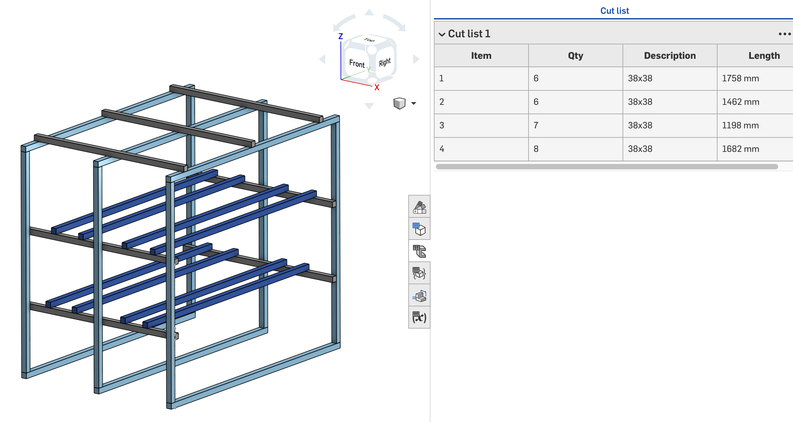

# Workbench cutting-list optimiser

[](https://cad.onshape.com/documents/8608ce6f867f33ab569ca052/w/8a5d516d4df43a47e6b1b93d/e/4a74294b8823b9d80d560135)


```toml
# stock.toml — purchasable lengths and prices per material code
[38x38]
options = [
    { mm = 3600, price =  40.00 },
    { mm = 4800, price =  63.50 },
    { mm = 6600, price =  83.00 },
]

[38x114]
options = [
    { mm = 3600, price = 115.50 },
    { mm = 4800, price = 154.00 },
    { mm = 6000, price = 241.80 },
]
```

End-to-end loop for a parametric workbench design:

1. Adjust dimensions in CAD
2. Export a cut list from Onshape (two flows — see below)
3. Run `cutlist` — solves the stock-minimisation problem, minimising cost
4. See how the design change affected total stock cost
5. Repeat, settling on dimensions that nest well into purchasable stock

The solver finds the minimum-cost combination of purchasable bar lengths for
each material, prints a per-bar cutting layout with offcuts, and produces a
shopping list. It proves optimality via CP-SAT (Google OR-Tools). Output is
also saved as `out/out.svg` after every run.

## Setup

```bash
uv sync   # creates .venv and installs ortools, rich, and the CLI commands
```

## Configure stock

Edit `stock.toml` — material codes must match what Onshape exports:

```toml
[38x38]
options = [
    { mm = 3600, price =  40.00 },
    { mm = 4800, price =  63.50 },
    { mm = 6600, price =  83.00 },
]
```

Price units can be anything consistent. Drop cut lists into `cutlists/` — that
directory is gitignored so exports never accidentally get committed.

## Usage

### Flow 1 — Frame tool (Part Studio cut list)

The faster flow. Works directly from a Part Studio with the Frame feature —
no assembly required.

**One-time Onshape setup per profile sketch:**
> Part Studio → select the profile sketch → **Tag Profile** → set
> **Description = `38x38`** (matching the key in `stock.toml`)

This makes the profile name flow into the cut list's `Description` column.
Repeat for each profile. After that it's automatic.

**Export:**
> Custom Tables panel → Cut List → three-dot menu → **Copy table to clipboard**

Paste into a `.tsv` file in `cutlists/`, then run:

```bash
uv run cutlist cutlists/frame_cutlist.tsv --frame
```

The TSV columns (`Item`, `Qty`, `Description`, `Length`) are read directly —
no extra flags needed. Multiple profiles in one Part Studio are handled
automatically via the `Description` column.

### Flow 2 — Assembly BOM (legacy / non-frame parts)

For parts modelled without the Frame tool. Uses a FeatureScript to write
bounding-box lengths into `Title 2`, then exports from the assembly BOM.

**Onshape setup:** a FeatureScript runs as the last feature in the Part Studio
tree, writing the longest bounding-box dimension into `Title 2`. Parts are
assigned stock type via a custom material (right-click → Assign material →
Custom tab) — the material name must match a key in `stock.toml`.

**Export:**
> Assembly → BOM panel → **Edit BOM table** → show `Name`, `Quantity`,
> `Material`, `Title 1`, `Title 2`. Flat view. → **Export** → CSV.

Expected header:
```
Item,Quantity,Name,Title 1,Material,Title 2
```

```bash
uv run cutlist cutlists/bom.csv
uv run cutlist cutlists/bom.csv --kerf 4 --trim 20
uv run cutlist cutlists/bom.csv --csv out/layout.csv
```

Defaults: `--kerf 3` mm per cut, `--trim 10` mm per bar end. Rows with
material `- None -` or a blank `Title 2` are skipped and reported on stderr.

<details>
<summary>FeatureScript source</summary>

```
FeatureScript 3070;
import(path : "onshape/std/geometry.fs", version : "3070.0");

annotation { "Feature Type Name" : "Stock size" }
export const stockSize = defineFeature(function(context is Context, id is Id, definition is map)
    precondition
    {
        annotation { "Name" : "Parts", "Filter" : EntityType.BODY && BodyType.SOLID }
        definition.parts is Query;
    }
    {
        for (var part in evaluateQuery(context, definition.parts))
        {
            var bb = evBox3d(context, { "topology" : part, "tight" : true });

            var a = (bb.maxCorner[0] - bb.minCorner[0]) / millimeter;
            var b = (bb.maxCorner[1] - bb.minCorner[1]) / millimeter;
            var c = (bb.maxCorner[2] - bb.minCorner[2]) / millimeter;

            var big = max(a, max(b, c));
            var small = min(a, min(b, c));
            var mid = a + b + c - big - small;

            big = round(big);
            mid = round(mid);
            small = round(small);

            var dims = toString(big) ~ " x " ~ toString(mid) ~ " x " ~ toString(small);

            setProperty(context, { "entities" : part, "propertyType" : PropertyType.TITLE_1, "value" : dims });
            setProperty(context, { "entities" : part, "propertyType" : PropertyType.TITLE_2, "value" : toString(big) });
        }
    });
```

The `3070` version number is account/release specific — keep the two header
lines the editor generates when pasting into a fresh Feature Studio.

**Known limitation:** the bounding box is axis-aligned to the Part Studio
origin. Parts modelled on a skew report an oversized box.

</details>

### Parameter sweep

Export one cut list per candidate value of a driving dimension (bench length,
say), name the files `bom_1400.csv`, `bom_1500.csv`, …, then:

```bash
uv run sweep cutlists/
uv run sweep cutlists/ --output out/cost.png
uv run sweep cutlists/ --no-plot   # table only
```

The sweep prints a cost-vs-dimension table with plateau-edge markers and plots
a step function. The annotated x-values are the useful places to sit: the
largest bench you can build before the cost jumps.

## Gotchas

- **Tag Profile is a one-time step per sketch.** Once set, the Description
  flows into every future cut list export automatically.
- **`Title 2` exports as text** in the assembly BOM. Spreadsheets left-align
  it; the optimiser casts it, but watch for this if opening the CSV by hand.
- **Duplicate part names** make the workshop output hard to follow. Keep names
  meaningful (`leg_back_left`, `side_long_front`).
- **Re-run the FeatureScript after geometry changes** (assembly flow). Confirm
  `Title 2` updated before exporting.

## Decisions

**No Onshape REST API.** Free/Standard accounts get 2,500 API calls per year,
which would make an automated sweep something to ration. Exporting by hand is
fast enough for the iteration rate here.

**Frame tool over custom features.** The Frame tool + Tag Profile gives a
clean cut list with profile info at no scripting cost. The FeatureScript
assembly flow is kept for parts that predate the Frame refactor.

**Bounding box over authored part lengths.** A spreadsheet of part lengths
driving the model was rejected — it inverts the intended workflow. The design
is exploratory; lengths must be *derived* from the geometry, not declared ahead
of it.

**FreeCAD migration is under consideration**, motivated by not wanting to
depend on Onshape's free tier indefinitely:

- STEP export carries geometry and part names but **not** material assignments.
- `Shape.optimalBoundingBox()` gives an oriented box and is the better choice
  over the axis-aligned `Shape.BoundBox`.
- Custom properties (`App::PropertyString` named `Stock`) are free at every
  tier and readable from Python.
- FreeCAD would remove the API call ceiling entirely — recompute locally in a
  loop as fast as the machine goes.
- **But** the modelling paradigm is a worse fit. The design is skeleton-driven:
  part dimensions fall out of constraints on a master layout. Onshape's
  multi-part-studio / in-context workflow supports that well. FreeCAD's
  cross-body references (`SubShapeBinder`) are its weakest area and a known
  source of breakage.
