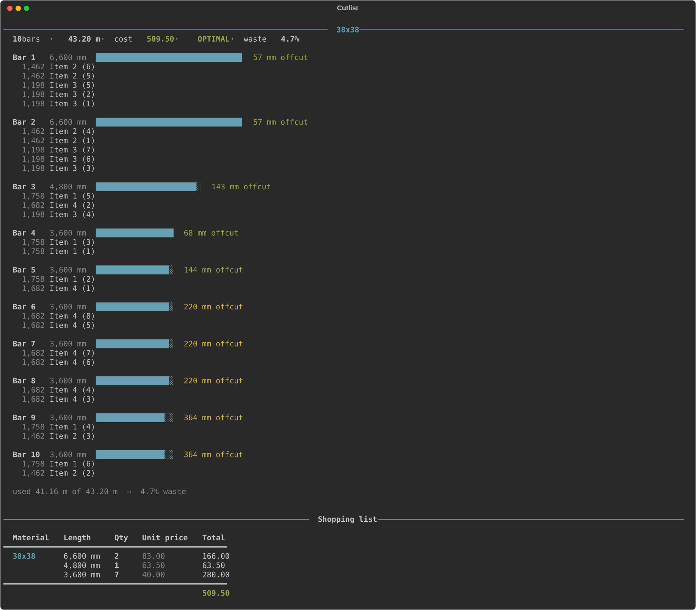

# Workbench cutting-list optimiser



```toml
# stock.toml — purchasable lengths and prices per material code
[38x38]
options = [
    { mm = 3600, price =  40.00 },
    { mm = 4800, price =  63.50 },
    { mm = 6600, price =  83.00 },
]

[38x114]
options = [
    { mm = 3600, price = 115.50 },
    { mm = 4800, price = 154.00 },
    { mm = 6000, price = 241.80 },
]
```

End-to-end loop for a parametric workbench design:

1. Adjust dimensions in CAD
2. Export a BOM CSV from the Onshape assembly
3. Run `cutlist` — solves the stock-minimisation problem, minimising cost
4. See how the design change affected total stock cost
5. Repeat, settling on dimensions that nest well into purchasable stock

The solver finds the minimum-cost combination of purchasable bar lengths for
each material, prints a per-bar cutting layout with offcuts, and gives a cost
total. It proves optimality via CP-SAT (Google OR-Tools).

## Setup

```bash
uv sync   # creates .venv and installs ortools, matplotlib, and the CLI commands
```

## Usage

### Single BOM

```bash
uv run cutlist "BOM of Assembly 1.csv"
uv run cutlist "BOM of Assembly 1.csv" --kerf 4 --trim 20
uv run cutlist "BOM of Assembly 1.csv" --csv layout.csv
```

Defaults: `--kerf 3` (mm lost per cut), `--trim 10` (mm docked off each bar
end for squaring). At 26 pieces the kerf alone is close to a metre — both
values matter.

### Parameter sweep

Export one BOM per candidate value of a driving dimension (bench length, say),
name the files `bom_1400.csv`, `bom_1500.csv`, …, then:

```bash
uv run sweep boms/
uv run sweep boms/ --output cost.png
uv run sweep boms/ --no-plot          # table only
```

The sweep prints a cost-vs-dimension table with plateau-edge markers and plots
a step function. The annotated x-values are the useful places to sit: the
largest bench you can build before the cost jumps. Those points are typically
30–40 mm away from whatever round number you'd pick by hand.

## Configure stock

Edit `stock.toml` before first use — the defaults are placeholders:

```toml
[A]  # 70 × 50 PAR pine
options = [
    { mm = 2400, price = 18.50 },
    { mm = 3000, price = 22.00 },
    { mm = 3600, price = 27.00 },
]
```

Material codes (`A`, `B`, …) must match the `Material` column in the BOM
export. Price units can be anything consistent (dollars, pence, cost-per-metre).

## CAD setup (Onshape)

### Materials

Parts are assigned stock type via a **local custom material** (right-click part
→ Assign material → Custom tab). Currently `A` (70×50) and `B` (150×50).

Worth renaming these to `70x50` and `150x50` in Onshape — the optimiser keys
off whatever string lands in the Material column, so better names flow straight
through to the report.

### FeatureScript

Lives in a Feature Studio in the same document, added to the toolbar, and runs
as the **last feature in the Part Studio tree**. Writes the bounding-box
dimensions into `Title 1` (e.g. `1800 x 150 x 50`) and the longest dimension
alone into `Title 2` (e.g. `1800`) — which is what the optimiser reads.

```
FeatureScript 3070;
import(path : "onshape/std/geometry.fs", version : "3070.0");

annotation { "Feature Type Name" : "Stock size" }
export const stockSize = defineFeature(function(context is Context, id is Id, definition is map)
    precondition
    {
        annotation { "Name" : "Parts", "Filter" : EntityType.BODY && BodyType.SOLID }
        definition.parts is Query;
    }
    {
        for (var part in evaluateQuery(context, definition.parts))
        {
            var bb = evBox3d(context, { "topology" : part, "tight" : true });

            var a = (bb.maxCorner[0] - bb.minCorner[0]) / millimeter;
            var b = (bb.maxCorner[1] - bb.minCorner[1]) / millimeter;
            var c = (bb.maxCorner[2] - bb.minCorner[2]) / millimeter;

            var big = max(a, max(b, c));
            var small = min(a, min(b, c));
            var mid = a + b + c - big - small;

            big = round(big);
            mid = round(mid);
            small = round(small);

            var dims = toString(big) ~ " x " ~ toString(mid) ~ " x " ~ toString(small);

            setProperty(context, { "entities" : part, "propertyType" : PropertyType.TITLE_1, "value" : dims });
            setProperty(context, { "entities" : part, "propertyType" : PropertyType.TITLE_2, "value" : toString(big) });
        }
    });
```

The `3070` version number is account/release specific. If this is ever pasted
into a fresh Feature Studio, keep the two header lines the editor generates
rather than these.

**Known limitation:** the bounding box is axis-aligned to the Part Studio
origin. Parts modelled on a skew report an oversized box — none currently do.
Tapered or curved parts report finished size rather than blank size — also not
currently an issue, but the first thing to check if a number looks wrong.

### Exporting the BOM

Assembly → BOM panel → menu → **Edit BOM table** → show `Name`, `Quantity`,
`Material`, `Title 1`, `Title 2`. Flat view, not structured. Then menu →
**Export** → CSV.

Expected header row:

```
Item,Quantity,Name,Title 1,Material,Title 2
```

Rows with material `- None -` or a blank `Title 2` are skipped and reported on
stderr. Currently that's `Part 26` and `top` — expected, since `top` is not a
plank.

## Gotchas

- **Re-run the FeatureScript after geometry changes.** It should regenerate
  automatically as a tree feature, but confirm `Title 2` actually updated
  before trusting an export.
- **`Title 2` exports as text.** Spreadsheets left-align it and sort `900`
  above `1200`. The optimiser casts it, but watch for this if the CSV is opened
  by hand.
- **Duplicate part names** make the workshop output useless. Parts are
  currently named meaningfully (`leg_back_left`, `side_long_front`); keep that
  up for anything new.
- **Quantity column is honoured** — a row with qty 4 expands to four pieces.
  Currently every row is qty 1.

## Decisions

**No Onshape REST API.** Free/Standard accounts get 2,500 API calls per year,
which would make an automated sweep something to ration. Downloading the CSV by
hand is fast enough for the iteration rate here. Worth revisiting only if the
account tier changes.

**Not using Onshape Frames.** Frames + the native Cut list feature is the
Onshape-sanctioned approach, but the model was already built with ordinary
features and the joinery is extensive. Retrofitting wasn't worth it.

**Bounding box over authored part lengths.** A spreadsheet of part lengths
driving the model was rejected — it inverts the intended workflow. The design
is exploratory; lengths must be *derived* from the geometry, not declared ahead
of it.

**FreeCAD migration is under consideration**, motivated by not wanting to
depend on Onshape's free tier indefinitely:

- STEP export carries geometry and part names but **not** material assignments.
- `Shape.optimalBoundingBox()` gives an oriented box and is the better choice
  over the axis-aligned `Shape.BoundBox`.
- Custom properties (`App::PropertyString` named `Stock`) are free at every
  tier and readable from Python.
- FreeCAD would remove the API call ceiling entirely — recompute locally in a
  loop as fast as the machine goes.
- **But** the modelling paradigm is a worse fit. The design is skeleton-driven:
  part dimensions fall out of constraints on a master layout. Onshape's
  multi-part-studio / in-context workflow supports that well. FreeCAD's
  cross-body references (`SubShapeBinder`) are its weakest area and a known
  source of breakage.
